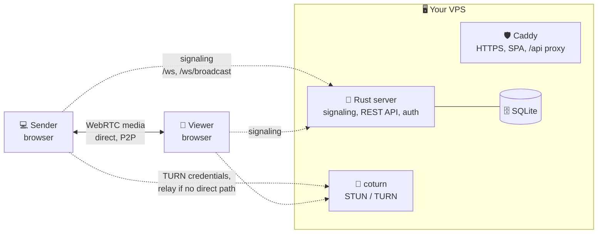

# 🐝 Streambree


**Peer-to-peer media and screen streaming between your own devices.** Video and audio flow directly from device to device over WebRTC. The server only handles signaling and hands out STUN/TURN credentials, so connections still work behind CGNAT. It's built for a small invited group, with 1:1 streams, channels with roles and 1-to-many broadcasts, plus a shared file area.

(The code and some docs still use the earlier name, `stream_lover`.)

---

## ✨ Features

| | Feature |
|---|---|
| 🖥️ | **Screen, camera and file streaming** from the browser. Mobile browsers that lack screen capture default to file streaming. |
| ⚡ | **Two modes.** Real-time (low latency) or High quality (buffered). The mode is a client-side WebRTC setting, so the server is identical for both. |
| 🎵 | **High-quality audio.** Audio-only files (MP3, WAV, FLAC, OGG, AAC, M4A) play through a native audio element, with stereo Opus at up to 320 kbps and voice processing turned off. |
| 🔗 | **Easy pairing.** Share a room code for a one-off 1:1 stream, or pair through your account. |
| 📡 | **Broadcast to a channel.** Go live to many viewers. The sender fans out directly to each viewer and the media stays peer-to-peer. |
| 👥 | **Channels with roles.** Owner, admin and member roles, revocable invite links, add-by-email, kick, role changes, ownership transfer, blocking a member from streaming, and force-stopping a stream. |
| 📂 | **Shared files.** A web file explorer for a shared storage folder, with upload, delete and new folder (admin only). An optional qBittorrent container can download into the same folder. |
| 🔐 | **Invite-only by default.** Signups are off, and the admin is created from environment variables on first boot. The owner can add and delete users, and users can change their username and password. |
| 🌐 | **Direct or relay.** A status chip shows whether the connection is direct or going through TURN. |
| 🎨 | **Six themes:** Breeze, Midnight and Ember (dark), Paper, Sky and Sand (light). |

---

## 🗺️ How it works



The server crate layout (`server/crates`):

| Crate | Role |
|---|---|
| `api` | REST routes and WebSocket handlers (auth, users, channels, invites, shared files, signaling) |
| `signaling` | 2-peer room state machine and the 1-to-N broadcast hub |
| `auth` | JWT auth and argon2 password hashing |
| `store` | SQLite persistence and migrations |
| `turn` | Ephemeral coturn credentials (REST auth-secret scheme) |

The web client (`web/`) is React, TypeScript and Vite. A framework-agnostic, unit-tested core (`web/src/core`: protocol, connection state machine, signaling client, RTC session, modes, sources, broadcast) sits under a thin UI. See [web/README.md](web/README.md) and [web/DESIGN.md](web/DESIGN.md).

### Status

Server and web client are done and in use. Native desktop and Android clients are not built yet.

---

## 🚀 Develop

```bash
# server (Rust)
cd server
cargo test                                           # whole server test suite
JWT_SECRET=dev TURN_SECRET=dev cargo run -p stream_lover_server

# web client
cd web
npm install
VITE_SERVER_URL=http://localhost:8080 npm run dev
npm test
```

Server settings come from environment variables, including `DATABASE_URL`, `JWT_SECRET`, `TURN_SECRET`, `SIGNUPS_ALLOWED` (default `false`) and `ADMIN_EMAIL` / `ADMIN_PASSWORD` for the first admin.

---

## 📦 Deploy

Streambree is designed for a Debian VPS that already has **podman** and **Caddy**. One script does the work:

```bash
git clone https://github.com/sahuishan01/streambree.git
cd streambree
./setup.sh stream.example.com
```

It generates secrets, builds the server image and web client in throwaway containers (no Rust or Node needed on the host), starts coturn and the signaling server, and writes the Caddy config for automatic HTTPS. Open these ports: 80 and 443 (TCP), 3478 (UDP and TCP) and 49152 to 65535 (UDP, TURN relay).

To update only the web UI, run `./deploy-web.sh stream.example.com`. It backs up the current site and prints a rollback command. The full runbook, with verification steps, backups and secret rotation, is in [DEPLOY.md](DEPLOY.md), and the coturn and container files are in [server/deploy/](server/deploy).

---

## 📚 More

[CHANGELOG.md](CHANGELOG.md) has the release history. [HANDOFF.md](HANDOFF.md) has the latest session notes. Design specs and plans are in [docs/superpowers](docs/superpowers).
